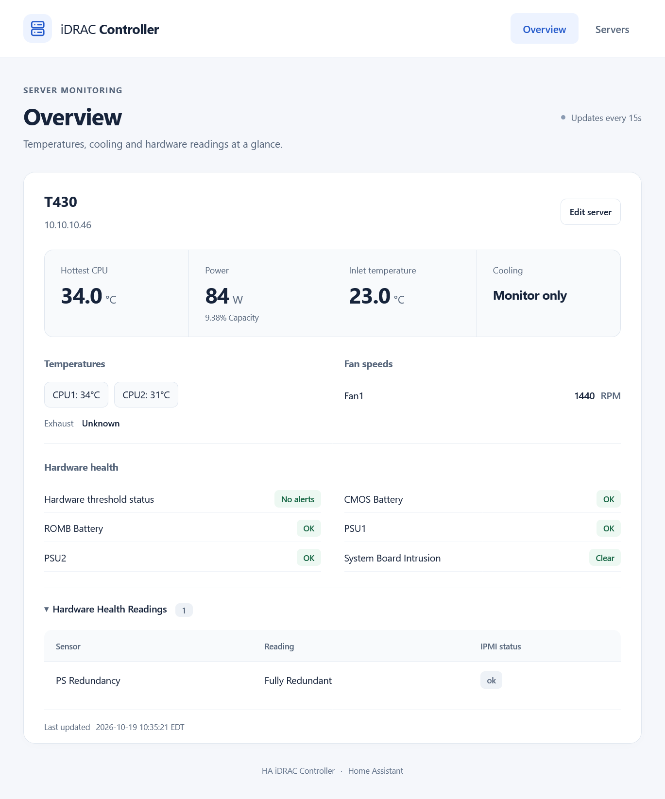
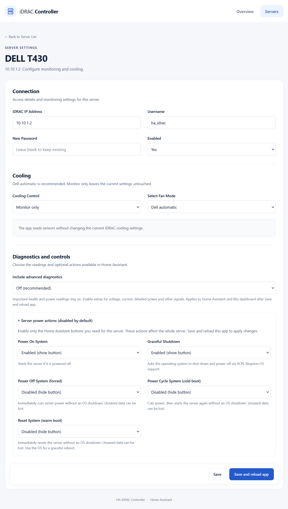
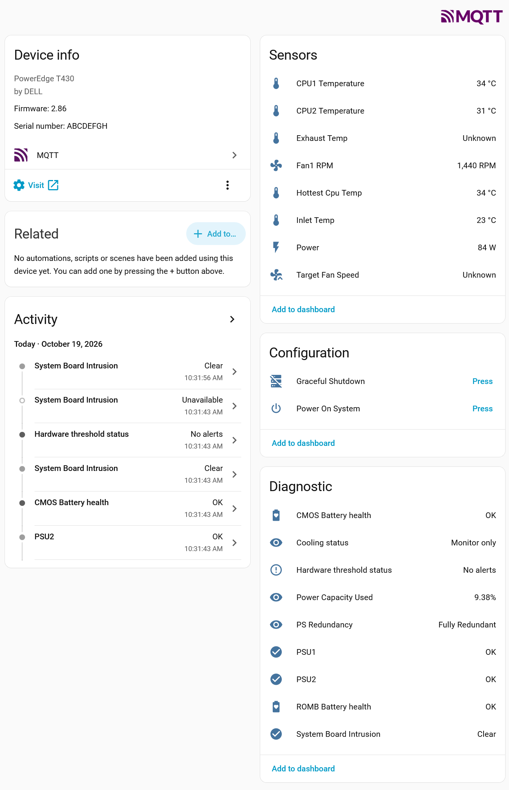

<p align="center">
  
</p>

Monitor Dell PowerEdge servers with iDRAC 7 or 8 in Home Assistant over IPMI.
Each server becomes an MQTT device with temperatures, fan speeds, power and
hardware health. Optional controls manage cooling and server power.

[Screenshots](#screenshots) · [Install](#install) · [Setup](#setup) · [Sensors](#sensors) ·
[Controls](#controls) · [Troubleshooting](ha-idrac-controller/README.md#troubleshooting) ·
[Reference](docs/reference.md) · [Changelog](ha-idrac-controller/CHANGELOG.md)

## Screenshots

| Dashboard | Server settings | Home Assistant |
| --- | --- | --- |
| [](assets/screenshots/dashboard.png) | [](assets/screenshots/server-settings.png) | [](assets/screenshots/home-assistant.png) |

Select a screenshot to view it full size.

## Install

[](https://my.home-assistant.io/redirect/supervisor_add_addon_repository/?repository_url=https%3A%2F%2Fgithub.com%2Fsam2kb%2Fha-idrac-controller)

You need iDRAC 7/8 with IPMI over LAN enabled, an iDRAC Administrator account,
network access from Home Assistant to UDP 623, and an MQTT broker such as Mosquitto.
iDRAC 9 and newer are outside this app's scope.

1. In Home Assistant, open Settings, then Apps, then Install app.
2. Open the three-dot menu, choose Repositories, and add:

   ```
   https://github.com/sam2kb/ha-idrac-controller
   ```

3. Install HA iDRAC Controller.

## Setup

1. Leave MQTT host, username and password blank to use Supervisor's registered
   broker automatically. Enter connection details for a manual broker instead.
2. Start the app and open its Web UI.
3. In Manage Servers, add the iDRAC address and credentials for each server.
4. Choose Save and reload app to apply changes. Regular Save keeps them for
   the next reload. Reloading restarts only this app, not HA or your servers.

New servers use Dell automatic cooling. Existing saved custom profiles are
preserved. See the [app guide](ha-idrac-controller/README.md) for setup details.

## Sensors

Default entities cover CPU1/CPU2 and other temperatures, fan RPM, power and
capacity used, battery health, PSU problems, intrusion, redundancy and hardware
threshold alerts, when reported by the server.

For voltage/current, detailed power figures and other signals, enable Include
advanced diagnostics in the server's edit form, then Save and reload app.
The switch applies to both HA and the dashboard; it defaults to Off.

Unavailable values stay unknown. Battery health is not a charge percentage.
An absent exhaust sensor and a target fan speed in automatic mode can be unknown.
Temperatures use Celsius; HA may convert the display. Choose °C in each entity's
settings to override your HA unit preference.

See [sensor meanings and availability](docs/reference.md#sensors) for details.

## Controls

Choose Dell automatic, monitor only, or custom cooling per server. Monitor only
leaves iDRAC settings untouched. Custom modes offer thresholds, a curve or a
PID target. If a speed write fails, the app returns control to Dell automatic.
A hard container kill can skip cleanup and leave the last manual speed active;
the Supervisor watchdog restarts the app. Read the
[cooling reference](docs/reference.md#cooling) before using a custom profile.

Power actions are individually disabled by default. Enable them in Edit →
Server power actions. Enabled HA buttons have no extra confirmation.
Graceful Shutdown requests an OS shutdown; Reset, Power Cycle and forced Power
Off bypass normal shutdown and can lose unsaved data. See
[power actions](ha-idrac-controller/README.md#power-actions) before enabling them.

## Development

```sh
python -m pip install pytest -r ha-idrac-controller/app/requirements.txt
python -m pytest -q
```

Tests block external subprocess/network calls and need no server or broker.
GitHub Actions runs Python 3.14 and the Node UI tests on each push. Parser
fixtures cover iDRAC 7/8 variants. We have not tested every model and firmware on hardware.

### Container releases

The Publish container images workflow builds and signs native amd64 and aarch64
images, then checks startup, IPMI tooling, health and the dashboard without
network access. The shared version tag is published only after both pass.
Images live at `ghcr.io/sam2kb/ha-idrac-controller:<version>`.

For a new release, prepare its version on a branch and run the workflow there
with Run workflow. Verify the image is public and both architectures passed
before merging the version into main and creating its matching `v<version>` tag.
Tag builds also run the workflow; existing version tags are kept intact.
Home Assistant uses the version in `config.yaml`; registry credentials are not
needed for public images. On the first publication, set the GitHub package's
visibility to Public in its package settings.

## Credits

Based on [Aesgarth/HA-iDRAC](https://github.com/Aesgarth/HA-iDRAC).
See [MIGRATION.md](MIGRATION.md) for settings and behaviour differences. MIT license.
